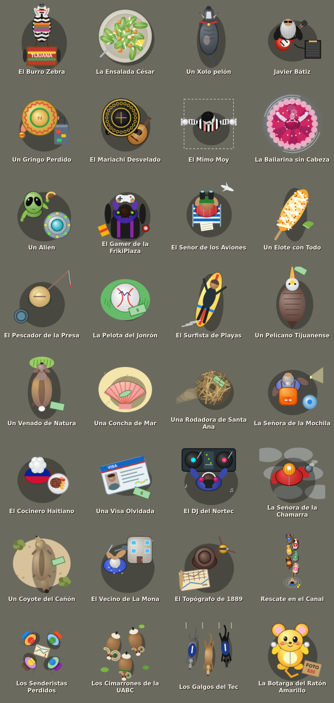

# TJ Rush · Tijuana

Juego de vista cenital estilo GTA 2 en Tijuana, con calles, edificios y lugares reales. Cubre toda la ciudad, unos 32 x 19 km: de Playas
(con el mar) a El Florido y Terrazas del Valle, y de la línea al límite con Rosarito (Santa Fe, Natura, San Antonio del Mar), pasando por el
Centro, la Zona Río, Agua Caliente, Otay, La Mesa, las 5 y 10 y La Presa.
Hecho con Phaser 3 (JavaScript); corre en el navegador.

## Jugar
- En línea: https://tonymoyoy.github.io/tjgta-proto/ (GitHub Pages sirve `index.html` desde `main`).
- Abre `dist/tjgta.html` en el navegador (un solo archivo, funciona sin internet).
- Para desarrollar: abre `index.html` (carga `src/` y `data/` por separado).

## Android
La app se arma con Capacitor a partir de los mismos archivos (`index.html`, `src/`, `data/`).
Requiere Node 22, JDK 21 y el Android SDK (`ANDROID_HOME`).
- `npm install` la primera vez.
- `npm run apk` copia el juego a `www/`, sincroniza `android/` y genera `android/app/build/outputs/apk/debug/app-debug.apk`.
- `npm run android` lo instala y abre en el celular conectado (depuración USB) o en el emulador.
- `npm run dev` sirve el juego en http://localhost:8080 para probar en el navegador.

## Controles
Flechas/WASD mover o manejar · E robar auto / bajarte · Espacio freno de mano · Shift correr ·
T trabajar de taxista · M mapa grande (toca para marcar destino). En celular hay joystick y botones.

## Actividades
- Lugares ★: 59 lugares reales: del Centro (Arco, Plaza Santa Cecilia, Catedral, Caesar's, Jai Alai...), la Zona Río (CECUT, El Cubo, Las Tijeras, glorietas...),
  Agua Caliente e Hipódromo (Estadio Caliente, el Campestre...) Otay y La Mesa (Garita de Otay, Aeropuerto, UABC, Las 5 y 10, El Trompo, Parque Morelos...) La Presa (Estadio de los Toros, Mirador del Cerro Colorado, Presa Rodríguez...) Playas (El Muro en la Playa, Faro, Malecón, El Colef...) y las orillas (Santa Fe, Natura, El Florido...).
- Ruta del taco 🌮: 205 taquerías reales del mapa (las que llegaron con cada ampliación, a 700 m o más una de otra; desde la última, a 1.5 km).
- Cafés ☕: 176 cafés reales para coleccionar.
  Las taquerías y cafés que te faltan se ven desde lejos: un pin con 🌮 o ☕ que flota sobre el puesto, una luz que late en el piso y el nombre en una etiqueta de color. Al visitarlos el pin se desinfla y el puesto queda más apagado. Los puestos y los cafés son sólidos: ni tú (a pie o en carro) ni la gente ni los perros pasan por encima; la gente y los perros los rodean por la banqueta.
- Comida china 🏮: 6 locales ficticios en la Calle Coahuila; al entrar pierdes dinero (no se coleccionan).
- Repartidor 🛵: roba una moto de repartidor (scooter con caja térmica verde, naranja, roja o azul) y entrega el pedido antes de que se acabe el tiempo.
- Taxi: recoge pasajeros y llévalos a un lugar antes de que se acabe el tiempo.
- Paros 🤝: 59 personajes en las colonias (lejos de los lugares típicos) te piden un favor: llevar al gato al veterinario, pozole a la jefa, flores al panteón, croquetas al albergue de perritos, una perrita rescatada con su nueva familia... Se aceptan con E (botón ACEPTAR), tienen tiempo y pagan según la distancia. Están en `PAROS` de src/game.js.
- Vehículos: 10 tipos (sedán, vocho, troca, camioneta, tsurito, combi, muscle car, lowrider, calafia, camión de carga), cada uno limpio o sucio y madreado. Los sucios aguantan menos golpes y corren un poco menos. Se dibujan en `vehicleTexture()` de src/game.js.
- Escoltas 🚙🚙: convoyes de dos camionetas negras con torreta ámbar (no son policías) que cruzan la ciudad en fila, un poco más rápido que el tráfico. Se pueden robar.
- Conductores erráticos 💥: algunos autos zigzaguean, no frenan por nadie y tarde o temprano se estrellan y quedan deshuesados; el tráfico les da la vuelta.
- Moto deportiva 🏍️: la más rápida del juego, pero se hace pedazos al primer choque. Sale seguido en el tráfico (máximo dos a la vez).
- Transporte público 🚌: camiones urbanos (y las calafias) que van a todo lo que da, rebasan, no frenan en los topes, se paran de golpe a subir pasaje y, si te les atraviesas, te pegan por detrás y te pitan. Se pueden robar.
- Pipas de gas ⛽: andan despacio por las colonias con su cancioncita. Al primer golpe fuerte se les sale el gas; al segundo explotan y la onda expansiva revienta los carros de alrededor (en cadena). Se pueden robar, con cuidadito.
- El carro del pan 🥖: una guayín vieja con una concha gigante en el techo y la bocina amarrada que anda despacio por las calles de las colonias (uno a la vez). Se oye su cancioncita y, si pasas cerca, sale un globo con "♪ ¡El panadero con el pan! ♪" o lo que va ofreciendo el panadero (`FRASES_PAN_CANCION` y `FRASES_PAN` de src/game.js). Se para a ratos a esperar a las señoras y también se puede robar.
- Explosiones 💥: destello, bola de fuego, chispas, pedazos, onda expansiva, humo negro, tizne en el piso y luz de noche; los carros de junto salen dañados.
- Personajes de la calle 🌽: entre la gente caminan eloteros y paleteros con su carrito, turistas con camisa hawaiana y cámara, albañiles con casco y cubeta, señoras del mandado, mamás con carriola, corredores, luchadores enmascarados, gente de la maquila con bata y gafete, estudiantes de uniforme, el señor de los globos y músicos con guitarra. Cada uno tiene sus frases.
- Perros callejeros 🐕: de varias razas (caramelo con paliacate, negro, con manchas, chihuahua, gris y peludo); caminan por la banqueta, se paran a olfatear y le ladran a quien pasa. Si atropellas uno sale chillando (entero, pero ofendido) y te cae el karma al azar: llega la jauría del barrio y te persigue mordiendo las llantas (o los tobillos), se te poncha una llanta (no corre y se jala de lado 45 s) o alguien grabó el video y pagas el veterinario.
- Gatos de azotea 🐈: seguido hay uno o dos arriba de alguna casa: naranja, negro, gris, blanco con manchas, calicó o siamés. Te sigue con la mirada y, si te le acercas, te dice lo que piensa de ti, de cómo manejas y del juego (rompe la cuarta pared). Si estaba dormido, se queja de que lo despertaste; tras unas cuantas frases se harta y se vuelve a dormir. Sus frases están en `FRASES_GATO` de src/game.js.
- Rateros 🦹: si te quedas parado en el carro unos segundos, a veces sale uno corriendo de la banqueta hacia tu puerta. Si llega, te baja y se va manejando como loco, gritando y pitando. Si arrancas antes, se rinde; si alcanzas tu carro, lo recuperas con E.
- Patrullas 🚓: trocas de policía en el tráfico (máximo 3). Si las chocas te cobran multa ($150–800 según la velocidad, una cada 5 s). No se pueden robar.
- Escenas de tráfico 💥: los cruceros donde más se choca en Tijuana (estudio Misión Cero 2015-2023, SSPCM y Bomberos): Aldrete y Negrete, Parque Baja California y Pedregal, Lázaro Cárdenas y la Vía Rápida, la Glorieta Cuauhtémoc, la Vía Rápida Poniente, Las 5 y 10, el Bulevar 2000 y la Glorieta Santa Fe. Al llegar a uno, 7 de cada 10 veces hay un choque, y no siempre el mismo: de lado, alcance, carambola de tres, esquinazo (uno se pasó el alto) o una moto tirada. Los carros tienen las intermitentes prendidas, hay vidrios en el piso, al que se dio de frente le sale humo, y los conductores discuten mientras el de tránsito los calma (a veces la patrulla todavía no llega y te piden que seas su testigo). El tráfico le da la vuelta y los carros no se pueden robar. Están en `ESCENAS` de src/game.js (cada una se pega a su calle real).
- Sobreruedas 🛍️: los mercados sobre ruedas de Tijuana en la calle donde se ponen: Zona Norte (Miguel F. Martínez), la Villa (Antonio Villareal), Playas (Paseo del Pedregal), Otay Bellas Artes, Otay Módulos (Sor Juana Inés de la Cruz), El Florido (Calle del Saucillo), La Curva (Ruta Mariano Matamoros) y la Sánchez Taboada (Cruz del Sur). En la vida real cada uno es un día o dos a la semana; aquí están siempre. Tienen puestos con lonas de colores (ropa de paca, fruta, juguetes, fierro viejo, tenis, plantas, pan y chácharas), vallas donde cruzan otras calles y gente comprando que se para a ver los puestos y te habla. La calle está cerrada a los carros (el tráfico y la flecha le dan la vuelta y tu carro no pasa de la valla) pero se camina. Están en `SOBRERUEDAS` de src/game.js.
- La fila de las garitas 🚗: en San Ysidro y en Otay siempre hay fila para cruzar a Estados Unidos. Los carriles que llegan a la línea están llenos de carros, defensa con defensa, que no se mueven (dejan libres los cruces con otras calles). No se pueden robar: nadie suelta su lugar en la fila. De vez en cuando alguien pita o te dice algo desde su carro. Entre los carros caminan vendedores (churros, agua, cobijas, figuras de yeso y dulces) que se paran en las ventanillas, pregonan y te ofrecen lo suyo si te les acercas (`VENDEDORES`). Las garitas están en `GARITAS` y las frases en `FRASES_FILA` de src/game.js.
- Secretos 🥚: 28 personajes y cosas típicas de Tijuana escondidos cerca de los lugares (el burro cebra, la ensalada César, Javier Bátiz, el Mimo Moy, el señor de los aviones, el pescador de la Presa, el surfista de Playas, un venado en Natura...). Al encontrarlos sueltan una frase y una lana. En las orillas hay 9 más que cuentan la historia de la ciudad: hechos recientes (el temblor de 2010, la llegada de los haitianos en 2016, la línea cerrada en 2020 y 2021), nostalgia (el Nortec, La Mona, el plano de 1889) y consejos de aquí (la Santa Ana, el mayo gris, los arroyos cuando llueve). Están en `EGGS` de src/game.js.

  

El progreso se guarda en el navegador (en la app, también en el almacén del teléfono), junto con dónde te quedaste: al volver a abrir apareces en el mismo lugar, y si ibas manejando, en el mismo carro.

Los árboles son sólidos: no se pueden atravesar a pie ni en carro (chocar fuerte contra uno daña el carro, como una pared, y los conductores erráticos se estrellan con ellos). Las copas van encima: la gente camina por debajo de ellas. Son de la región: laurel de la India, palma, jacaranda, pirul, eucalipto y pino. En las colonias las casas tienen jardincitos de pasto corto (regado, kikuyo o seco) con arbustos, bugambilias, magueyes, nopales y rosales, y en los patios de atrás a veces un limonero, naranjo o aguacate.
En las colonias donde el mapa no traía casas hay casitas con su tinaco y su patio atrás (barda, tendedero con ropa, tanque de gas, macetas, asador, casita del perro, lavadero...); adentro de las manzanas, lotes baldíos con yerbas y llantas y canchas de fútbol de tierra; y junto a las avenidas estacionamientos con sus cajones, postes de luz y carros estacionados que se pueden robar (se llenan al acercarte).
Lo que pasa detrás de un edificio (al norte, donde se dibujan sus paredes y su techo) se oculta; tú y tu carro se ven como fantasma.

## Estructura
- `src/game.js` lógica del juego (render del mapa en trozos, tráfico, peatones, actividades, HUD).
- `src/style.css` interfaz.
- `data/centro.js` el mapa sin edificios (calles, areas, lugares, frontera) y el indice de regiones.
- `data/reg/X_Y.js` los edificios, en regiones de 819 m que el juego carga cerca de donde andas y suelta de lejos
  (asi el mapa puede crecer a toda Tijuana sin cargar todo de un jalon); `data/reg/X_Y.png` la capa de edificios
  del minimapa de cada cuadro.
- `tools/download_overture.py` descarga datos de Overture Maps (S3 público) para un recuadro (variable `TJ_BBOX="xmin,ymin,xmax,ymax"`, igual en prep_data.py; por defecto Centro + Zona Río).
  Uso: `python3 download_overture.py transportation segment id,class,subtype,names,road_flags,access_restrictions`
  (también `buildings building ...`, `places place id,names`, `base land_use ...`, `base water ...`).
- `tools/prep_data.py RAW_DIR data/centro.js` convierte esos GeoJSON al formato del juego y genera `data/reg/`
  (aquí se eligen los lugares y taquerías). Necesita Pillow (capa del minimapa) y shapely (el mar y la línea fronteriza
  en la costa).
- `tools/rellenar.py` (despues de prep_data.py) llena el terreno vacio, donde al mapa le faltan las casas: casitas de una o dos plantas pegadas a la calle en las colonias (con su patio), lotes baldíos y canchas de tierra adentro de las manzanas, y estacionamientos con su plaza comercial junto a las avenidas y en las zonas comerciales. Se agregan a `data/reg/` (casitas `[h, contorno, 1, fondo del patio]`, plazas `[h, contorno, 2]`, estacionamientos `[-1, contorno]`, lotes `[-2, contorno]`, canchas `[-3, contorno]`) y rehace la capa del minimapa. Siempre sale igual y se puede volver a correr. Necesita numpy y Pillow.
- `tools/build.py` genera (no se suben al repo, ver .gitignore) `dist/tjgta.html` (todo en un archivo) y `dist/tjgta-artifact.html`.

## Datos
Overture Maps Foundation, derivados de © colaboradores de OpenStreetMap (ODbL). Recuadro:
lon -117.142 a -116.800, lat 32.390 a 32.565 (de Playas a Terrazas del Valle y de la línea al límite con Rosarito). El mar es el polígono del océano de Overture recortado al recuadro. La línea fronteriza es la de verdad (la orilla norte del polígono de México en `division_area`).
